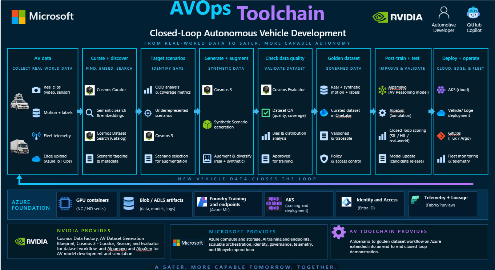

# AVOPS on Azure



The AVOPS workflow on Azure turns your curated driving data into targeted ODD insights and richer synthetic scenes—using the Cosmos DAG workflow or the optional CARLA + Cosmos pipeline.

This feature provides workflows for Autonomous Vehicles specific synthetic data generation using Nvidia PAIDF on a Kubernetes GPU cluster. The scripts configure and manage the workflow without vendoring or modifying its repository.

## 🚀 Quick Start

### Prerequisites

Install the following tools and configure access to a Kubernetes cluster with GPU capacity:

| Requirement                  | Purpose                                                |
|------------------------------|--------------------------------------------------------|
| Docker                       | Build and push the Airflow controller image            |
| `kubectl`                    | Access the Kubernetes cluster                          |
| Helm                         | Install workflow components                            |
| `make`                       | Run targets in the external SDG workflow repository    |
| Python 3.11+                 | Run workflow integration utilities                     |
| `curl`                       | Call the Airflow REST API                              |
| Kubeconfig                   | Authenticate to the target cluster                     |
| `NGC_API_KEY` and `HF_TOKEN` | Retrieve required container images and model artifacts |

The cluster needs a GPU node for GPU workloads. Preflight warns if Kubernetes reports no allocatable NVIDIA GPUs.

### Downloads, model access, and disk

The first run downloads these images, assets, source files, or model weights. The Hugging Face model pages require the user to sign in and accept their access terms before downloading. `HF_TOKEN` must belong to an account with access to each gated model.

| Artifact                                        | Source                                                                                                                 |     First-download size | Access and storage notes                                                                                                                                               |
|-------------------------------------------------|------------------------------------------------------------------------------------------------------------------------|------------------------:|------------------------------------------------------------------------------------------------------------------------------------------------------------------------|
| Cosmos-Reason2-2B                               | [Hugging Face model](https://huggingface.co/nvidia/Cosmos-Reason2-2B)                                                  |            About 4.9 GB | Accept the model's Hugging Face terms. Downloaded by the VLM service host into its Hugging Face cache; the ODD container calls that service through `ODD_VLM_URL`.     |
| CARLA 0.9.15 image                              | [`carlasim/carla:0.9.15` on Docker Hub](https://hub.docker.com/r/carlasim/carla/tags?name=0.9.15)                      | About 8.9 GB compressed | Pulled and stored in the local Docker image cache.                                                                                                                     |
| CARLA AdditionalMaps 0.9.15                     | [Official CARLA release archive](https://carla-releases.s3.eu-west-3.amazonaws.com/Linux/AdditionalMaps_0.9.15.tar.gz) | About 7.4 GB compressed | Downloaded during the CARLA image build, then extracted into the image. The extracted maps and retained build layers use additional disk.                              |
| Cosmos Transfer 2.5 source and Git LFS files    | [NVIDIA source repository](https://github.com/nvidia-cosmos/cosmos-transfer2.5)                                        |                  Varies | Cloned and built locally by `AVOPS/carla-cosmos/build-cosmos-image.sh`; allow additional space for the checkout, LFS objects, and Docker build cache.                  |
| Cosmos-Transfer2.5-2B                           | [Hugging Face model](https://huggingface.co/nvidia/Cosmos-Transfer2.5-2B)                                              |            About 4.8 GB | Accept the model's Hugging Face terms. Cached in the persistent `hf-cache` Docker volume used by the CARLA pipeline.                                                   |
| Cosmos-Predict2.5-2B                            | [Hugging Face model](https://huggingface.co/nvidia/Cosmos-Predict2.5-2B)                                               |            About 4.8 GB | Accept the model's Hugging Face terms. Cached in the same `hf-cache` volume.                                                                                           |
| Cosmos-Guardrail1 (when guardrails are enabled) | [Hugging Face model](https://huggingface.co/nvidia/Cosmos-Guardrail1)                                                  |                  Varies | Accept the model's Hugging Face terms. Not included in the current default download estimate; size depends on the selected model revision and guardrail configuration. |

The listed, quantified downloads total about **30.8 GB**. Treat this as a lower
bound, not a disk requirement: it excludes the Cosmos source/LFS checkout,
extracted CARLA maps, Docker image layers and build cache, and generated
outputs. Reserve at least **50 GB free** before building, and more if Docker
data, source checkouts, and generated videos share a disk. The `hf-cache` volume
persists CARLA model weights across runs; the VLM's cache is on the host or
container running the VLM service. Pre-fetch models into those caches or mirror
the linked sources when preparing an offline environment.

### Configure and Install

From the repository root, configure the external SDG workflow checkout and cluster credentials:

```bash
cp AVOPS/configs/sdg.env.example AVOPS/configs/sdg.env
```

Edit `AVOPS/configs/sdg.env` and set `SDG_WORKFLOW_DIR`, `KUBECONFIG`, `NGC_API_KEY`, and `HF_TOKEN`. The external checkout must contain a `Makefile` and `scripts/setup_airflow_secrets.sh`.

Then run:

```bash
AVOPS/scripts/sdg.sh preflight
AVOPS/scripts/sdg.sh --dry-run run
AVOPS/scripts/sdg.sh run
AVOPS/scripts/sdg.sh port-forward
```

The Airflow UI is available at <http://127.0.0.1:8080> while port forwarding is active. `--dry-run` prints the external `make` commands without executing them. It still validates the environment and required configuration.

## ⚙️ Configuration

`AVOPS/configs/sdg.env.example` lists the supported settings. Copy it to `AVOPS/configs/sdg.env`; the local file is excluded from Git.

| Setting                                                                                       | Required | Purpose                                                                                                                        |
|-----------------------------------------------------------------------------------------------|---------:|--------------------------------------------------------------------------------------------------------------------------------|
| `SDG_WORKFLOW_DIR`                                                                            |      Yes | Absolute path to the external SDG workflow checkout                                                                            |
| `KUBECONFIG`                                                                                  |      Yes | Path to the kubeconfig file for the target cluster                                                                             |
| `NGC_API_KEY`                                                                                 |      Yes | NVIDIA NGC authentication                                                                                                      |
| `HF_TOKEN`                                                                                    |      Yes | Hugging Face model-download authentication                                                                                     |
| `OSMO_TOKEN`, `VLM_API_KEY`, `LLM_API_KEY`                                                    |       No | Optional workflow service credentials                                                                                          |
| `AWS_S3_BUCKET`, `AWS_S3_REGION`, `AWS_S3_ACCESS_KEY_ID`, `AWS_S3_SECRET_ACCESS_KEY`          |       No | Optional S3 storage settings                                                                                                   |
| `AIRFLOW_IMAGE_REPOSITORY`, `AIRFLOW_IMAGE_TAG`                                               |       No | Airflow controller image overrides                                                                                             |
| `NFS_NAMESPACE`, `NFS_STORAGE_CLASS`, `NFS_EXPORT_PATH`, `NFS_NODE_HOSTNAME`, `NFS_SERVER`    |       No | NFS storage settings                                                                                                           |
| `AIRFLOW_URL`                                                                                 |       No | Airflow REST API URL; defaults to `http://127.0.0.1:8080`                                                                      |
| `AIRFLOW_USERNAME`, `AIRFLOW_PASSWORD`                                                        |       No | Airflow REST API credentials                                                                                                   |
| `SDG_DAG_ID`                                                                                  |       No | DAG to trigger; defaults to `autonomous_vehicle_dataset_generation_dag_k8s`                                                    |
| `ODD_IMAGE`, `ODD_VLM_URL`, `ODD_VLM_MODEL`, `ODD_VLM_INPUT`, `ODD_THRESHOLD`, `ODD_MOCK_VLM` |       No | ODD container image, VLM endpoint, model and input (`video` clip or first `frame`), gap threshold, and offline mock perception |
| `ODD_MAX_RUNS`                                                                                |       No | Cap on generation runs started from ODD gaps; empty or `0` means no cap                                                        |
| `CARLA_COSMOS_VIEWS`, `COSMOS_GPU_IDS`, `CARLA_GPU_ID`                                        |       No | CARLA backend camera views, Cosmos GPUs, and CARLA's GPU                                                                       |
| `SDG_POLL_INTERVAL`, `SDG_RUN_TIMEOUT`                                                        |       No | Seconds between DagRun state polls and the maximum wait per run                                                                |

Values exported in the shell take precedence over values in `sdg.env`. The loader reads simple `NAME=value` lines; keep secrets and environment-specific values out of tracked files.

## 🧭 Commands

Run `AVOPS/scripts/sdg.sh --help` to display the available commands.

| Command                     | Action                                                                                                                                                    |
|-----------------------------|-----------------------------------------------------------------------------------------------------------------------------------------------------------|
| `preflight`                 | Check required tools, credentials, kubeconfig, and cluster access                                                                                         |
| `setup`                     | Run preflight, then generate Helm secret values in the external repository                                                                                |
| `nfs`                       | Install the host NFS export and Kubernetes StorageClass                                                                                                   |
| `build`                     | Build and push the Airflow controller image                                                                                                               |
| `install`                   | Install or upgrade the SDG controller                                                                                                                     |
| `run`                       | Run preflight, setup, NFS installation, image build, and controller installation in order                                                                 |
| `port-forward`              | Forward the Airflow UI to `http://127.0.0.1:8080`                                                                                                         |
| `trigger <payload>`         | Submit a JSON payload to the configured Airflow DAG                                                                                                       |
| `odd-build`                 | Build the ODD gap-analysis image from `AVOPS/ODD`                                                                                                         |
| `odd <in> <out>`            | Run the ODD container on a directory of videos                                                                                                            |
| `pipeline <payload>`        | Run curation, ODD gap analysis, then generation (one run per gap); `--backend carla` generates with CARLA + Cosmos Transfer multi-view instead of the DAG |
| `carla <odd-dir> [out-dir]` | Generate from an existing ODD output with CARLA + Cosmos Transfer 2.5 multi-view                                                                          |
| `uninstall`                 | Uninstall the controller                                                                                                                                  |

Individual installation steps can be run separately when needed. For example:

```bash
AVOPS/scripts/sdg.sh setup
AVOPS/scripts/sdg.sh nfs
AVOPS/scripts/sdg.sh build
AVOPS/scripts/sdg.sh install
```

## ▶️ Trigger a Dataset Generation Run

Start port forwarding in one terminal:

```bash
AVOPS/scripts/sdg.sh port-forward
```

In another terminal, trigger a payload from the external SDG workflow repository:

```bash
AVOPS/scripts/sdg.sh trigger payloads/dev/autonomous_vehicle_dataset_generation_dag/cdf-avdg-real-retrieval.json
```

Payload paths can be absolute or relative to the external repository. The script submits the payload as the `payload` field in the DAG run configuration. Use `--dry-run` to print the REST request without submitting it:

```bash
AVOPS/scripts/sdg.sh --dry-run trigger payloads/dev/autonomous_vehicle_dataset_generation_dag/cdf-avdg-real-retrieval.json
```

The trigger command obtains a bearer token from the Airflow authentication endpoint, then posts the run to the configured DAG. Set `AIRFLOW_URL`, `AIRFLOW_USERNAME`, `AIRFLOW_PASSWORD`, and `SDG_DAG_ID` in the environment or `sdg.env` as required by the deployment.

## 🔍 ODD Gap Analysis Between Curation and Generation

The SDG DAG runs curation, Cosmos Dataset Search retrieval, and generation as one run. The ODD (Operational Design Domain) step is spliced in from this feature without changing the external repository: `sdg.sh pipeline` runs the DAG twice around the ODD container.

```text
sdg.sh pipeline <payload>
├── 1. curation    DAG run with search_mode "none" and generation disabled
├── 2. ODD         ODD container on <output_directory>/<run_id>/split/clips
│                  writes the gap report to <output_directory>/<run_id>/odd/
└── 3. generation  one DAG run per ODD gap
                   query_video = ODD base clip, cosmos.prompt = ODD paragraph
```

```bash
AVOPS/scripts/sdg.sh --dry-run pipeline <payload.json>   # show the stages
AVOPS/scripts/sdg.sh pipeline <payload.json>             # curation -> ODD -> generation
AVOPS/scripts/sdg.sh odd-build                           # rebuild the ODD image after changing AVOPS/ODD
AVOPS/scripts/sdg.sh odd <videos-dir> <output-dir>       # run only the ODD container
```

The ODD container runs with host networking and reaches the VLM at `ODD_VLM_URL` (default `http://127.0.0.1:8010/v1`, model `ODD_VLM_MODEL`). Set `ODD_MOCK_VLM=1` to use heuristic perception when no VLM endpoint is available. The VLM receives the whole clip by default; `ODD_VLM_INPUT=frame` sends only the first frame.

The image is built from `AVOPS/ODD` on first use; run `odd-build` to rebuild it after changing the component.

### The ODD component

[`AVOPS/ODD`](./ODD/README.md) is part of this repository and is built locally into the `odd-component:latest` image. It runs in three phases on a directory of driving videos:

1. **Perception:** sends each clip to a VLM (Cosmos-Reason2 by default) for scene attributes such as weather, time of day, road, traffic lights, and other agents. Existing `Text_Annotations/` are reused, and `ODD_MOCK_VLM=1` or the offline fallback produces heuristic annotations.
2. **Coverage:** scores each attribute's entropy against the targets in `ODD/configs/odd_coverage_spec.json` and flags gaps below `ODD_THRESHOLD` (default `0.8`).
3. **Variation solver:** selects base clips for every gap and writes the variation specifications and one prompt paragraph per variation.

| Path                                       | Purpose                                                    |
|--------------------------------------------|------------------------------------------------------------|
| `ODD/run_odd_pipeline.py`                  | Command-line entry point of the container                  |
| `ODD/odd_core/`                            | Annotator, coverage engine, prompt writer, and VLM adapter |
| `ODD/configs/odd_coverage_spec.json`       | ODD categories, attributes, weights, and expected values   |
| `ODD/configs/qa_template.json`             | Visual questions asked for each attribute                  |
| `ODD/Dockerfile`, `ODD/docker-compose.yml` | Image build and a standalone Compose run                   |

The container writes these files to `<output>/odd/`, and the DAG and CARLA backends consume them:

| File                        | Used by                                                               |
|-----------------------------|-----------------------------------------------------------------------|
| `wfm_generation_input.json` | `sdg.sh carla` and `sdg_odd.py` (gaps, required counts, base clips)   |
| `generation_prompts.json`   | The DAG backend's `cosmos.prompt` for each gap                        |
| `final_gap_output.json`     | The ODD score, category scores, and recommendations (for you to read) |

Run the container alone with `sdg.sh odd <videos-dir> <output-dir>`, or see the [component README](./ODD/README.md) for its options and the Compose workflow. The prompt writer's tests are in `AVOPS/tests/test_odd_prompt_writer.py`.

For every `weatherType` and `timeOfDay` gap in `wfm_generation_input.json`, the pipeline triggers a generation run with the ODD base clip as `query_video`, `search_mode: embedding`, and `cosmos.enabled: true`. `cosmos.prompt` is the single paragraph the ODD module wrote for that scene variation in `generation_prompts.json`: the VLM summarizes the variation's attributes, with a deterministic template when the endpoint is offline.

If that file is missing, the fixed sentences in `AVOPS/configs/odd-prompts.json` are used, and gap values without a template are skipped. Gaps for any other attribute (road, traffic, agents) are not generated by the DAG backend; the CARLA backend covers those.

The remaining payload fields, such as `cosmos` settings and `top_k`, are inherited from the payload you pass in.

Constraints:

* `output_directory` must be a local path because the ODD container reads the curated clips from disk.
* Each generation run repeats curation on `input_video_path`; set `limit` in the payload to keep that cheap, and `ODD_MAX_RUNS` to bound the number of runs.
* Cosmos-Reason models are gated on Hugging Face; `ODD_VLM_MODEL` must be one your `HF_TOKEN` can access.

### CARLA backend: ODD gap, CARLA, Cosmos Transfer 2.5 multi-view

`--backend carla` replaces stage 3 (the per-gap DAG runs) with the [`AVOPS/carla-cosmos`](./carla-cosmos/README.md) pipeline. The ODD stage and everything before it are unchanged.

```bash
AVOPS/scripts/sdg.sh --backend carla pipeline <payload.json>   # curation -> ODD -> CARLA + Cosmos
AVOPS/scripts/sdg.sh carla <odd-output-dir> [out-dir]          # only the CARLA stage, from an ODD output
AVOPS/scripts/sdg.sh --dry-run --backend carla pipeline <payload.json>
```

For the CARLA stage, `sdg.sh`:

1. Validates the plan: the camera views fit the Cosmos GPUs, and at least one ODD gap maps to a CARLA scenario.
2. Stages `wfm_generation_input.json` in the pipeline's data directory.
3. Runs `run_pipeline.py`, which starts CARLA with Docker Compose, runs every scenario in the pipeline container through CARLA capture and Cosmos Transfer multi-view inference, and stops both containers afterwards.
4. Copies each finished task to `<output_directory>/<run_id>/carla/` (`multiview_grid.mp4`, `caption.txt`, `metadata.json`, `carla_simulation/`, `cosmos_synthesized/`) and writes `carla_results.json`. The command fails if any task did not finish, but keeps the tasks that did.

**Views and GPUs.** The default rig skips the narrow-FOV `front_tele` camera, leaving `front_wide`, `cross_left`, `cross_right`, `rear_left`, `rear_right`, and `rear`. This does not reduce the Cosmos GPU count.

Multi-view inference encodes one view per GPU rank, so the rank count must be at least the view count, and its attention splits the 2B model's 16 heads across ranks, so the rank count must divide 16.
That gives 4 GPUs for up to four views and 8 GPUs for five to eight; 6 is not valid. With the defaults:

| GPUs | Used by                                                                                |
|------|----------------------------------------------------------------------------------------|
| 0-7  | Cosmos Transfer multi-view (`COSMOS_GPU_IDS`), about 42 GB each in a six-view run      |
| 7    | Also CARLA (`CARLA_GPU_ID`, about 6 GB); GPU 0 can also hold the ODD VLM (about 17 GB) |

To use fewer GPUs, run four views (for example `CARLA_COSMOS_VIEWS=front_wide,cross_left,cross_right,rear`) with four `COSMOS_GPU_IDS`. The plan check rejects a view and GPU count that do not match.

Constraints:

* CARLA scenarios exist only for road width, traffic-light direction, road surface, lane change, cut-in, and pedestrian gaps. Other gaps, such as `weatherType` and `timeOfDay`, are listed and skipped; the stage fails if nothing maps.
* The CARLA images are built locally on first use (`AVOPS/carla-cosmos/build-cosmos-image.sh`); see [downloads, model access, and disk](#downloads-model-access-and-disk) for the asset sizes, sources, and Hugging Face access requirements.
* Prompts come from the CARLA pipeline's own prompt files, not the ODD paragraphs.
* Files under `AVOPS/carla-cosmos/data/runs/<run_id>/` are written by the container as root.

## 🏗️ Architecture

The CDF scripts are a thin operator interface to the external SDG workflow repository:

```text
Cosmos Data Factory
└── AVOPS/scripts/sdg.sh
    ├── validates local tools, credentials, and cluster access
    ├── invokes Makefile targets in the external SDG workflow checkout
    ├── submits DAG runs to the Airflow REST API
    ├── runs the ODD container (`AVOPS/ODD`, built locally) between curation and generation
    └── optionally generates with AVOPS/carla-cosmos (CARLA + Cosmos Transfer multi-view)
```

The external repository owns the Airflow DAGs, Kubernetes deployment, curation and generation stages, and payload definitions. CDF supplies the checkout path and deployment configuration; it does not copy or patch the external repository.

## 🔐 Security

Keep `sdg.env`, kubeconfig files, API keys, and storage credentials out of source control. Use environment variables or the Git-ignored local configuration file for deployment-specific values. Protect credentials with the access controls required by the target environment.
