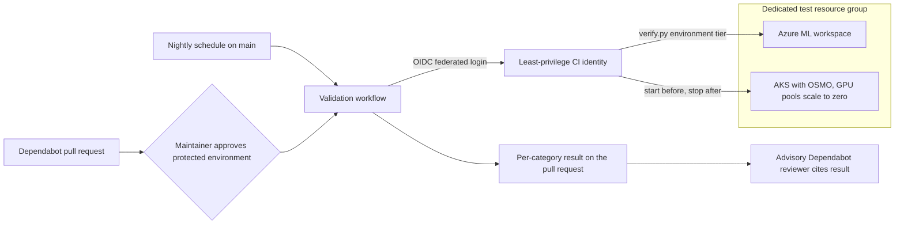

This record proposes one dedicated, isolated Azure test environment where CI runs the repository's Azure ML end-to-end and Dependabot environment-tier checks every night, and on demand once a maintainer approves. It replaces today's manual, VPN-bound verification so dependency bumps carry evidence that the code still works, not only that packages install.

## Context

The repository merges roughly two to three Dependabot pull requests a day, and every manifest and lockfile change routes to one review team. CI proves only that bumped packages resolve and import. Unit tests replace MLflow and the Azure SDK with mocks, no CI job runs real MLflow code, and no workflow runs `tests/e2e`. Behavior-level verification exists, but a person runs it from a workstation:

> Environment checks run against a deployed environment over its VPN; most submit Azure ML jobs, many of them on GPU nodes. ([Verifying Dependabot Updates](../../contributing/dependabot-verification.md))
> The replay mirror runs only inside OSMO, so its lock gets import smokes but no environment check. ([tests/dependabot/categories.json](pathname://../../../tests/dependabot/categories.json))
> CI has no GPU nodes and no access to deployed environments. ([Component Updates](../../contributing/component-updates.md))

Some breakages can only appear against real Azure. For example, `azureml-mlflow` 1.62.0.post6 declares support for `mlflow-skinny` up to 3.15.0, while the repository already overrides MLflow past that cap, and pending updates move it further. A local MLflow server never loads that plugin, so only a real workspace can show whether the Azure integration still works.

Two platform facts shape where that workspace can live:

* Workflows triggered by Dependabot pull requests run like forked pull requests, with a read-only token and no GitHub Actions secrets. Azure access must come from trusted triggers such as schedules, `workflow_dispatch`, or an approved environment.
* The E2E Terraform keeps state on the deploying machine by design, and a full deployment takes about 30 to 40 minutes for Terraform alone, then setup scripts.

## Decision Drivers

* Catch dependency-induced behavior changes before merge, including Azure-only behavior: the `azureml-mlflow` plugin, Microsoft Entra ID authentication, `azureml://` artifacts, and the model registry.
* Remove manual, VPN-bound environment-tier verification from engineers.
* Keep CI credentials least-privilege and away from Dependabot code that no maintainer has approved.
* Keep cost proportionate: no workspace per run, and GPUs billed only while jobs run.
* Reuse existing mechanisms: the E2E Terraform template and skills, `tests/e2e`, `tests/dependabot` and `verify.py`, and the Azure Automation start runbook.

## Considered Options

* Dedicated, isolated Azure test environment
* Reuse an existing shared team GPU environment
* Ephemeral environment provisioned and destroyed per run
* Dedicated private environment reached through VNet-injected runners
* Status quo: manual verification over VPN, plus in-CI MLflow checks only

## Decision Outcome

Chosen option: "Dedicated, isolated Azure test environment", because it is the only option that meets every decision driver with the repository's current code and constraints.

| Decision driver                          | Dedicated environment                       | Shared team environment                    | Ephemeral per run                                      | Private via VNet runners          | Status quo                |
|------------------------------------------|---------------------------------------------|--------------------------------------------|--------------------------------------------------------|-----------------------------------|---------------------------|
| Catches Azure-only breakage before merge | Yes                                         | Yes                                        | Yes                                                    | Yes                               | Only when someone runs it |
| Removes manual verification              | Yes                                         | Yes                                        | Partly; about an hour or more per run                  | Yes                               | No                        |
| Least-privilege CI credentials           | Yes; scoped to one resource group           | Weaker; credential in a shared environment | No; deployer must grant roles and hold Terraform state | Yes                               | Yes; no CI credential     |
| Proportionate cost                       | Base of about $50-100 a month plus run time | Lowest added cost                          | About $0 between runs                                  | Base cost plus larger-runner cost | About $0                  |
| Reuses existing mechanisms               | Yes                                         | Yes                                        | Conflicts with local Terraform state                   | Adds runner infrastructure        | Yes                       |

The environment operates as follows:

* Deployment: one instance from the existing E2E Terraform template, in its own resource group, with Microsoft Entra ID-authenticated public endpoints so GitHub-hosted runners can reach it. Move it to its own subscription when it would otherwise compete with team environments for GPU quota, budget, or policy.
* Lifecycle: deployed but paused. GPU pools scale to zero after 30 idle minutes on low-priority VMs. A workflow step or runbook starts AKS and PostgreSQL before a run and stops them afterward.
* Triggers: a nightly run on `main`, and an on-demand run for a Dependabot pull request after a maintainer approves it through a protected GitHub environment.
* Identity: a federated OIDC identity with no stored secret, holding `AzureML Data Scientist` (or a custom MLflow-scoped role) on the workspace and a namespace-scoped Kubernetes role for the OSMO gateway, never the broad AKS RBAC Writer role.
* Entry point: `tests/dependabot/verify.py` runs the environment tier for the changed categories from a non-secret environment bundle supplied to the job, and posts a per-category result to the pull request.

### Consequences

* Good, because Azure-only breakage, such as the `azureml-mlflow` plugin running past its declared MLflow cap, surfaces nightly or before merge instead of after.
* Good, because engineers approve and read results instead of running 90 to 150 minute checks by hand over VPN.
* Good, because the existing verification map in `tests/dependabot/categories.json` stays the single source of truth for which checks prove which dependency safe.
* Good, because CI credentials are short-lived, secret-free, scoped to one resource group, and used only for trusted triggers or approved runs.
* Bad, because the environment adds an always-on base cost of roughly $50-100 a month for managed services, plus AKS hours during run windows and GPU time per job.
* Bad, because the team takes on another environment to patch, upgrade, and keep in step with the E2E Terraform.
* Bad, because the instance exposes Microsoft Entra ID-authenticated public endpoints, a wider network surface than the private default posture.
* Bad, because approved runs execute freshly bumped packages with Azure credentials; isolation and least privilege bound the blast radius but do not remove the risk.
* Neutral, because three code gaps must close first: `verify.py` needs an OSMO connection step, the OSMO replay test must join the environment tier, and the CI roles must be defined.

### Confirmation

* A design review by the deciders and the security reviewer confirms the identity's role assignments and the protected-environment approval rule before any credential is issued.
* The success criteria in this record's metadata are reviewed 60 days after the workflow is enabled.
* An Azure budget alert on the test resource group or subscription confirms spend stays within the approved budget.

## Pros and Cons of the Options

### Dedicated, isolated Azure test environment

One instance from the E2E template, its own resource group, deployed but paused, reached by GitHub-hosted runners with an OIDC identity.

* Good, because it covers Azure-only behavior on a schedule and on approved pull requests.
* Good, because it follows Azure guidance to reuse one workspace and scale training clusters to zero.
* Good, because it isolates CI credentials from team environments.
* Bad, because it adds an always-on base cost and an environment to operate.
* Bad, because it relies on public, Entra-authenticated endpoints.

### Reuse an existing shared team GPU environment

Point the same workflow at an environment people already use for training.

* Good, because it adds little or no infrastructure cost and works with the same bundle-driven entry point.
* Bad, because CI runs compete with people's jobs for GPU quota and can disturb shared state.
* Bad, because a CI credential inside a shared environment widens the blast radius of a compromised bump.
* Neutral, because it remains a useful target for maintainer-approved runs before the dedicated instance exists.

### Ephemeral environment provisioned and destroyed per run

Deploy the full stack for each run and tear it down afterward.

* Good, because it costs about nothing between runs and starts from a clean state.
* Bad, because each run spends about an hour or more on provisioning and setup before any test.
* Bad, because the stack creates many role assignments, so the CI identity must be able to grant roles.
* Bad, because Terraform state is local by design and a CI runner cannot resume or destroy an instance it did not create in the same job.

### Dedicated private environment reached through VNet-injected runners

Keep private endpoints and a private AKS API, and run CI on GitHub-hosted larger runners joined to the environment's virtual network, or on a self-hosted runner inside it.

* Good, because it keeps the strongest network posture.
* Bad, because VNet injection is available only for larger runners, which cost more and are limited to certain regions.
* Bad, because a self-hosted runner adds a machine to secure and maintain.
* Neutral, because it remains the fallback if policy forbids public endpoints on the test instance.

### Status quo: manual verification over VPN, plus in-CI MLflow checks only

Keep environment-tier verification manual, and add only a real MLflow server in CI for client-side checks.

* Good, because it needs no Azure credentials in CI and no new spend.
* Good, because an in-CI MLflow server still catches MLflow client API changes on every pull request.
* Bad, because Azure-only breakage is found only when someone remembers to run the environment tier, or after merge.
* Bad, because the verification burden stays with engineers.

## Risks and Mitigations

| Risk                                               | Mitigation                                                                                                                                             |
|----------------------------------------------------|--------------------------------------------------------------------------------------------------------------------------------------------------------|
| Bumped packages run with Azure credentials         | Approval gate through a protected GitHub environment, OIDC with no stored secret, roles scoped to the test resource group only                         |
| Public endpoints on the test instance              | Entra ID authentication, test-only data, least-privilege identity; fall back to the private option if policy requires it                               |
| Nightly runs report not-run because AKS is stopped | Start AKS and PostgreSQL as a workflow step, align the Automation start schedule with the run window, and treat not-run as a failure in scheduled runs |
| Cost overrun from GPU jobs                         | Low-priority pools with minimum zero nodes and a 30-minute idle timeout, run only changed categories on pull requests, and an Azure budget alert       |
| Environment drifts from the E2E Terraform          | Periodic rebuild from scratch, run by a person or a separately privileged job, which also exercises infrastructure dependency bumps                    |
| Over-broad Kubernetes permissions for OSMO access  | Namespace-scoped role limited to the port-forward the gateway needs; confirm the minimal permission during implementation                              |

## Rollback / Exit Strategy

* Disable the validation workflow; the manual environment tier and CPU-tier CI continue to work unchanged.
* Remove the federated credential and role assignments for the CI identity.
* Undeploy the instance with the `e2e-infrastructure` skill, which confirms the exact resource group before deleting and purges soft-deleted resources.
* Mark this record `deprecated`, or supersede it if a different environment strategy replaces it.

## Affected Components

* `.github/workflows`: a new workflow for nightly and approved runs, using a protected GitHub environment and OIDC.
* `tests/dependabot`: an OSMO connection step in `verify.py`, the OSMO replay test in the `workflows` category's environment checks, and a result summary for the pull request.
* `tests/e2e`: no structural change; the suite already targets an existing workspace through an environment bundle.
* `training/utils/aml_mirror.py`: honors the repository's tracking-backend switch so the companion in-CI MLflow check can exercise it without Azure.
* `infrastructure/terraform/automation`: a stop counterpart to the existing start runbook, or a schedule aligned with the run window.
* `.github/skills/e2e-infrastructure`: guidance for the dedicated CI instance, including its resource group, identity, and budget alert.
* `docs/contributing/dependabot-verification.md`: updated Known Gaps and a description of the automated tier.

## More Information

A companion change, not an alternative, runs the real MLflow client against a throwaway MLflow server in ordinary CI with SQLite storage. It catches MLflow client API changes on every pull request at almost no cost, while this decision covers what only Azure can show. The OSMO replay mirror is the first path to adopt it.

Revisit this decision when any of these change:

* GitHub allows Dependabot pull request workflows to obtain an Azure OIDC token without elevated trust.
* Policy forbids public endpoints on test environments; switch to the private option.
* Spend consistently exceeds the approved budget, or the success criteria are missed after 60 days.

References:

* [Configure MLflow for Azure Machine Learning](https://learn.microsoft.com/azure/machine-learning/how-to-use-mlflow-configure-tracking)
* [Manage models registry with MLflow in Azure Machine Learning](https://learn.microsoft.com/azure/machine-learning/how-to-manage-models-mlflow)
* [Azure Well-Architected Framework service guide for Azure Machine Learning](https://learn.microsoft.com/azure/well-architected/service-guides/azure-machine-learning)
* [Architecture strategies for testing](https://learn.microsoft.com/azure/well-architected/operational-excellence/testing)
* [Subscription considerations and recommendations](https://learn.microsoft.com/azure/cloud-adoption-framework/ready/landing-zone/design-area/resource-org-subscriptions)
* [Authenticate to Azure from GitHub Actions by OpenID Connect](https://learn.microsoft.com/azure/developer/github/connect-from-azure-openid-connect)
* [Manage roles in your Azure Machine Learning workspace](https://learn.microsoft.com/azure/machine-learning/how-to-assign-roles)
* [Use Azure RBAC for Kubernetes authorization](https://learn.microsoft.com/azure/aks/manage-azure-rbac)
* [Troubleshooting Dependabot on GitHub Actions](https://docs.github.com/code-security/dependabot/troubleshooting-dependabot/troubleshooting-dependabot-on-github-actions)
* [About Azure private networking for GitHub-hosted runners](https://docs.github.com/organizations/managing-organization-settings/about-azure-private-networking-for-github-hosted-runners-in-your-organization)
* [MLflow backend stores](https://mlflow.org/docs/latest/self-hosting/architecture/backend-store/)
* [azureml-mlflow 1.62.0.post6 on PyPI](https://pypi.org/project/azureml-mlflow/1.62.0.post6/)

---

🤖 Crafted with precision by ✨Copilot following brilliant human instruction, then carefully refined by our team of discerning human reviewers.
